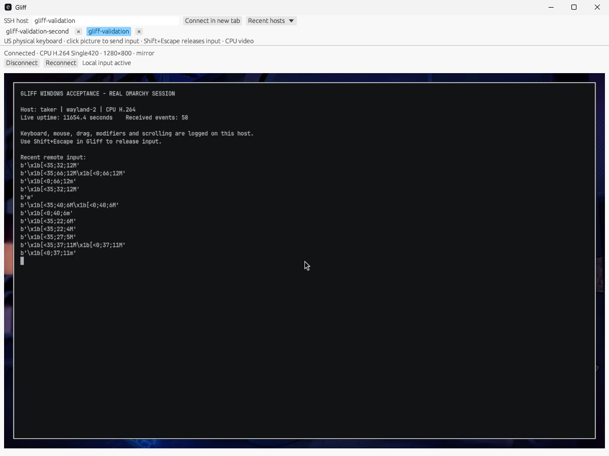
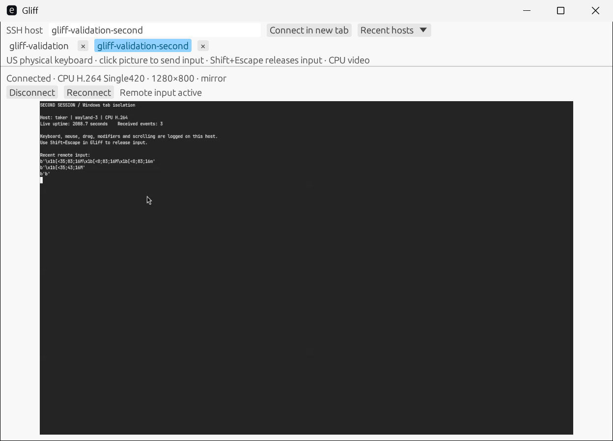
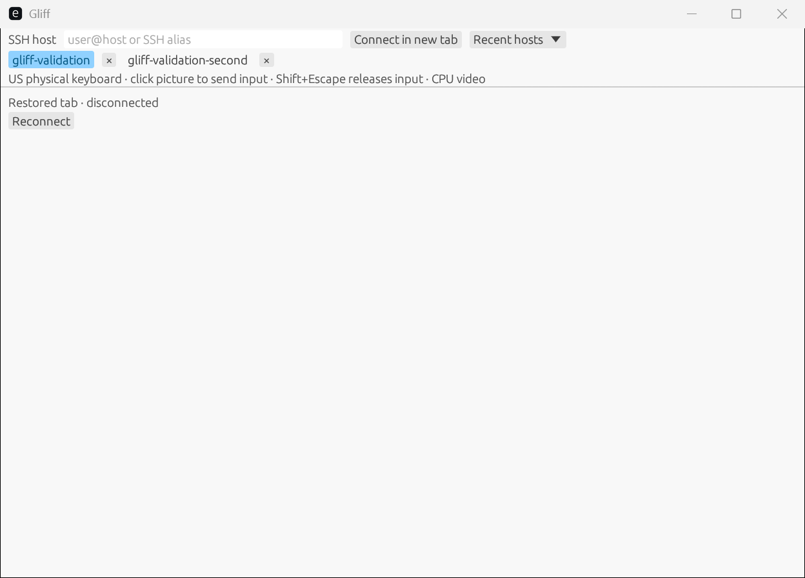
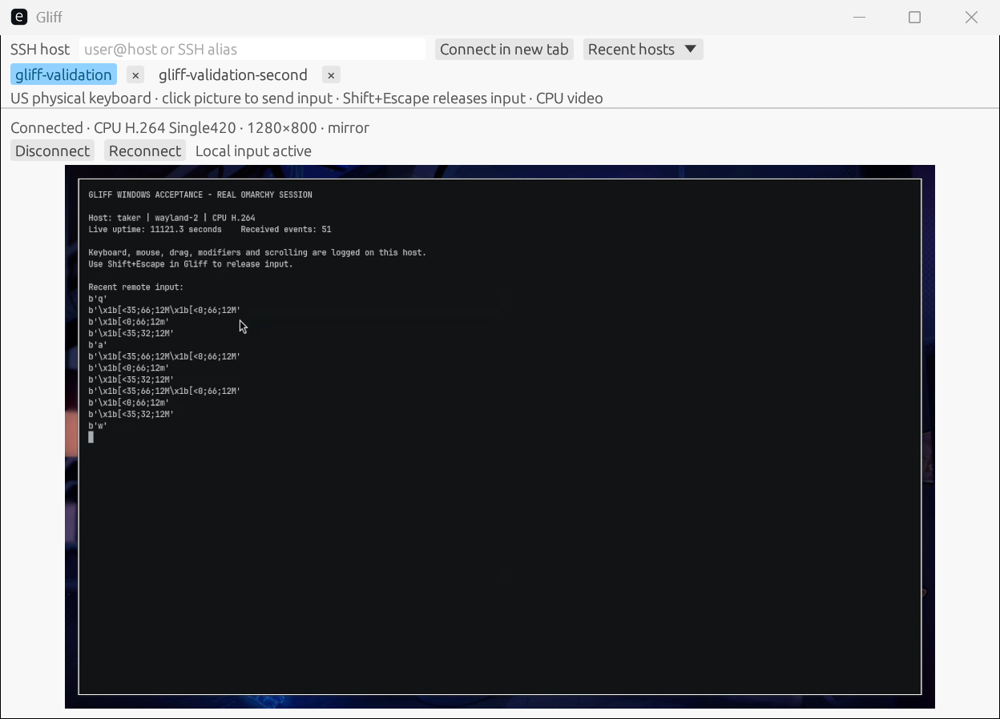
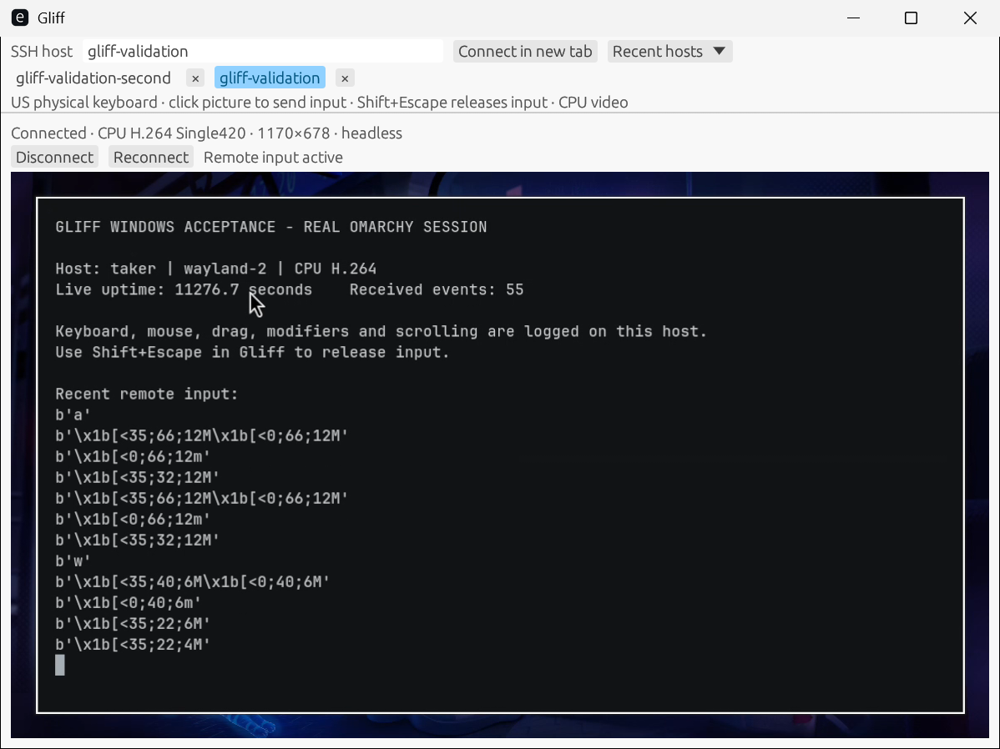
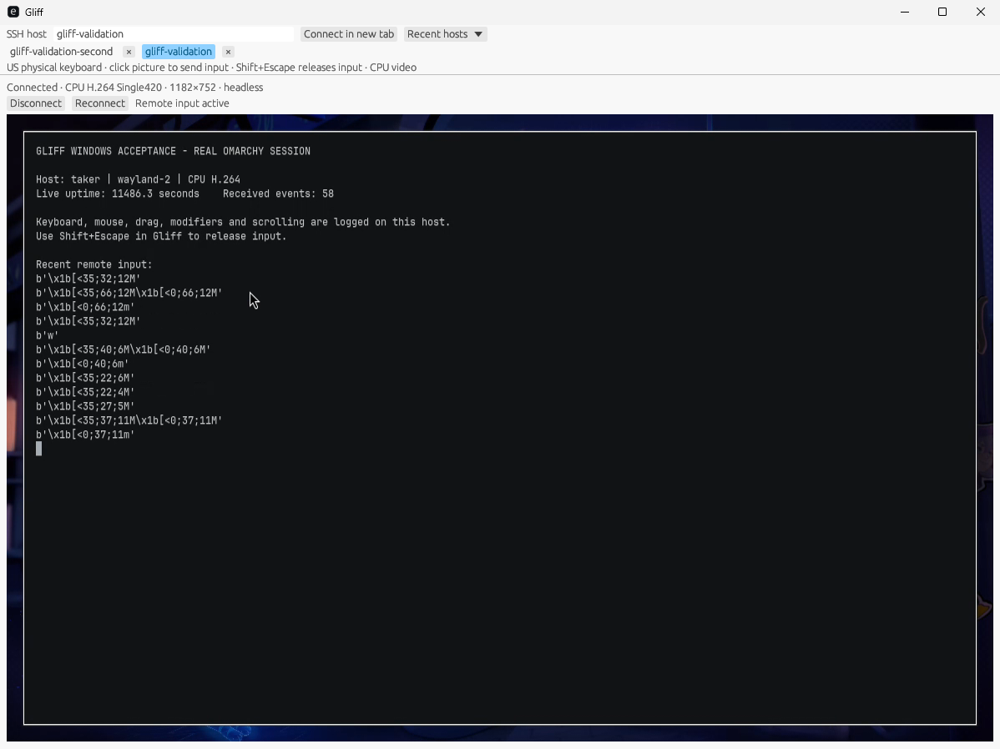
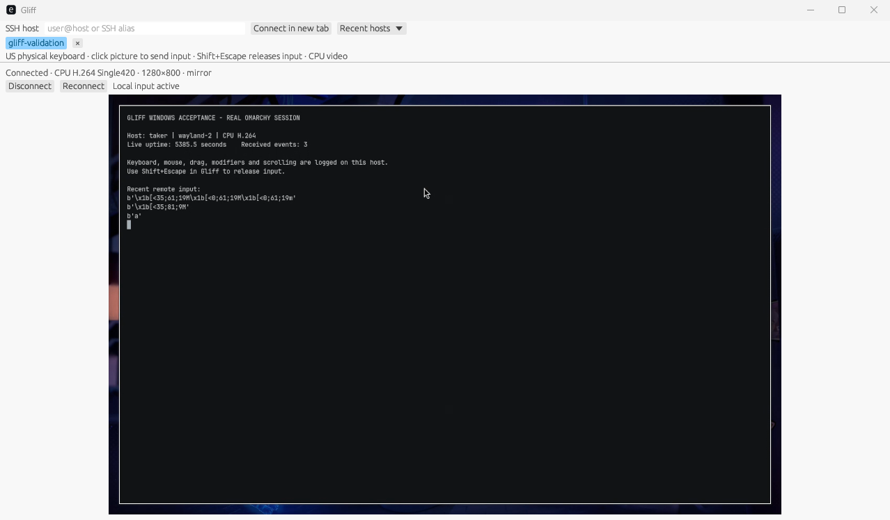
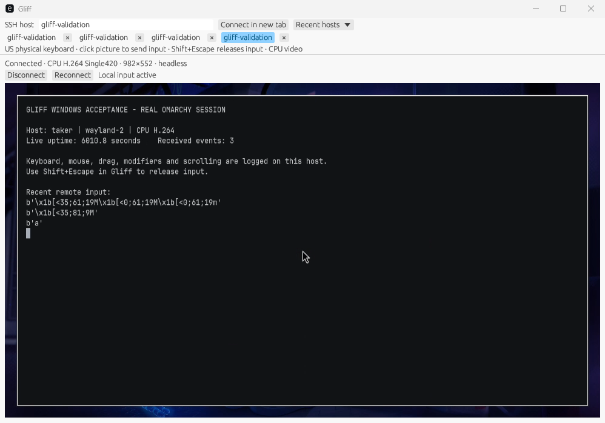
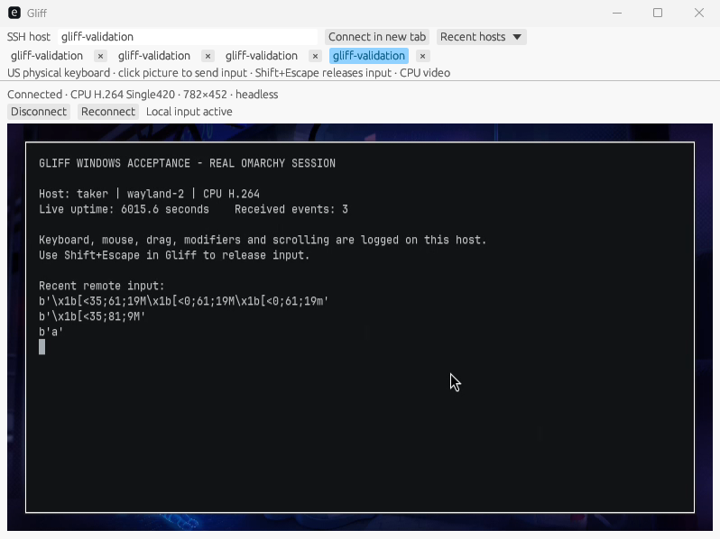

# Windows acceptance evidence

Status: **the W01–W11 acceptance gate passed**. The final product revision is
`04aab37337f3d5e6cb8919408b74102ad1c32f92`; subsequent changes contain documentation
and evidence only. The specification and observable pass conditions were written
before implementation in [windows-plan.md](windows-plan.md).

## Environment and build identity

- Fork review: https://github.com/spencerbull/gliff/pull/1 (draft for user testing).
- Final native artifact run: [42653722673](https://github.com/spencerbull/gliff/actions/runs/42653722673).
  Its MSVC build, Clippy, tests, static CRT/import/dependency checks and Windows
  SDK packaging checks passed. [Recorded CI identity](evidence/windows/04aab37-ci.json).
- Tested portable executable SHA-256:
  `c4c5fd00fa21a1f225d654253c56f18d3accd20d4262194e96e7e0ec65948437`.
  Both installed MSIX versions contained this exact executable.
- Windows: Enterprise Evaluation 26H2, x64, CIM version **10.0.26300.9457**,
  account `GLIFF-WINTEST\glifftest`, interactive session 1. The desktop evaluation
  watermark shows the older base build; CIM is the authoritative version.
- Isolated local Docker/KVM VM: 8 vCPU, 16 GiB RAM, 100 GB disk. Omaprox access
  was unavailable. No Rust, Visual Studio or Windows SDK was installed in the
  guest. QGA, Cua Driver and portable ffmpeg were test infrastructure.
- Two independent nested Hyprland compositors on the Omarchy host, Wayland
  `wayland-2` and `wayland-3`, each with a 1280×800 `GLIFF-VALIDATION` output and
  independent raw terminal input logger. Final tests ran the branch-built
  Gliff 0.4.2 server; the installed server and real user session were untouched.
- SSH used ephemeral test keys, pinned host keys, a constrained test-only sshd
  and an isolated reverse relay. No user SSH settings or firewall rules changed.
  All GUI actions used Cua Driver in the disposable guest.

## Acceptance matrix

| ID | Result | Evidence |
| --- | --- | --- |
| W01 | Pass | Final native MSVC/Clippy/tests and dependency/import/CRT checks, linked CI run above. |
| W02 | Pass | [Clean guest version/hash result](evidence/windows/04aab37-portable.json), GUI screenshots and video; no developer tools. |
| W03 | Pass | [100-second continuous final-build video](evidence/windows/04aab37-remote-session.mp4), changing real remote uptime; complete source and excerpt decode passed. [Hashes and processing](evidence/windows/04aab37-video.json). |
| W04 | Pass | [Wayland key events](evidence/windows/04aab37-xkb-events.log), [raw terminal events](evidence/windows/04aab37-first-input.jsonl), wheel/drag/Ctrl-click and literal `gliff`; Shift+Escape blocks input. Alt+Tab left subsequent text unmodified; authoritative minimize/restore [focus test](evidence/windows/04aab37-minimize-focus.json) blocked keys until recapture. |
| W05 | Pass | Final native [150% pointer](evidence/windows/04aab37-dpi150.json), [100% click](evidence/windows/04aab37-dpi100.json), independent [headless resize readback](evidence/windows/04aab37-headless150-resize.json), screenshots below; mirror aspect fit and remote cursor visible. |
| W06 | Pass | [Two-tab video](evidence/windows/04aab37-tabs.mp4), [independent routing assertions](evidence/windows/04aab37-tab-routing.json), disconnect removes only its SSH child, [automatic reconnect](evidence/windows/04aab37-reconnect.json), [restored tabs with zero SSH](evidence/windows/04aab37-restored-processes.json), restored-tab reconnect screenshot below. |
| W07 | Pass | Final-build [exact Unicode both ways](evidence/windows/04aab37-clipboard-enabled.json); focused [no-clipboard isolation](evidence/windows/04aab37-no-clipboard.json) preserves distinct selections after enabled sessions exit. |
| W08 | Pass | Native unknown/changed host, missing SSH/server and valid incompatible-v99 errors on a097f81, with process cleanup; those transport paths are unchanged. Final 04aab37 [interrupted established-session recovery](evidence/windows/04aab37-reconnect.json) and [zero-process teardown](evidence/windows/04aab37-cleanup.json). Historical screenshots below. |
| W09 | Pass | Native SDK validation; final test-signed [install](evidence/windows/04aab37-msix-Install.json), registered Start AUMID and alias GUI/CLI, [upgrade](evidence/windows/04aab37-msix-Upgrade.json), [uninstall](evidence/windows/04aab37-msix-Uninstall.json), [certificate/process cleanup](evidence/windows/04aab37-cleanup.json). Package paths/hashes independently recorded. |
| W10 | Pass | Fork branch and PR CI produce portable ZIP, MSIX, checksums and separate disposable-VM fixtures. Native winget semantic validation and invalid-scope control passed; production generator requires actual public URLs and hashes. |
| W11 | Pass | Full Linux `scripts/check.sh`: fmt, warnings-denied Clippy and **327 tests**, one existing ignored. Independent reviewers' confirmed defects reproduced, fixed and covered by failing defect mutations/regressions. |

Public trusted signing, a published release with stable URLs, and actual winget
submission remain **manual release gates**. No public release or submission was
made. Acceptance covers Windows x64/US physical keyboard and CPU decoding; IME
and other keyboard layouts, OS-reserved shortcuts, image/file clipboard, ARM64,
and Windows hardware decoding are documented limitations, not claimed parity.
No macOS implementation existed in the baseline.

## Final-build runtime evidence

At 150%, desktop position `(300,350)` mapped to remote logical `(190,95)`;
at 100%, a real click at the same desktop position mapped to `(291,212)`.
Compositor cursor readback and terminal mouse reports independently confirm
these results. The headless output changed from 1170×678/scale 1.5 to
972×558/scale 1.5 when the window shrank, then to 1182×752/scale 1 at 100%.

The keyboard observer independently recorded A down/up, Ctrl+Shift+V with
correct modifier sequence/releases, Shift+1 as `!`, Delete, and two NumLock
transitions returning effective modifiers to zero. Terminal logs record both
initial double-click pairs, held-button drag motion/release, all four wheel
directions, Ctrl-click, and literal `gliff`. Shift+Escape stayed local and
blocked following input. A minimized state was confirmed before restore;
posted and real foreground `q` stayed local until a picture click, after which
unmodified `q` arrived. Alt+Tab alone did not establish persistent blur and is
not used as proof of inactive blocking.

The two-tab test selected the second compositor and sent `b`: first log unchanged,
second log received `b`. Selecting the first and sending `a` changed only its
log. Disconnect left the other SSH child alive. Terminating only the owned first
server triggered automatic reconnect to a new PID; capture remained released
until a picture click. Closing both sessions and reopening without a host
restored both tabs disconnected, with no SSH children; explicit reconnect worked.

The 2136.6-second original recording is retained locally under
`~/.local/share/gliff-windows-test/shared/acceptance/evidence/gliff-04aab37-acceptance/`.
Committed clips are continuous source intervals 1000–1100s (live video/input)
and 1910–2010s (two-tab routing), scaled to 960×540 at 5 fps with unchanged timeline
speed. The entire original and both excerpts decoded without errors. Hashes,
commands and build identity are in the video JSON; screenshots preserve native
resolution. JSON/text logs normalize line endings and trailing diagnostic padding;
the original response/log bytes remain in the local test artifact directories. The [492-second DPI/MSIX lifecycle video](evidence/windows/04aab37-dpi-msix.mp4)
is also committed at 960×540/5 fps; its original is retained alongside it.

The final MSIX CER was trusted only in the disposable VM. Registered-app launch
ran from the 0.4.2.0 `WindowsApps` directory; alias GUI launch after upgrade ran
from 0.4.2.1. Both executable hashes matched the tested portable build.
[Initial process identity](evidence/windows/04aab37-msix-aumid-process.json) and
[upgraded alias identity](evidence/windows/04aab37-msix-alias-process.json) record
the actual paths. Uninstall removed package, Start entry and alias; exact test
CER `3EF56F9F3E84AF3F0DBF8CDF34443B177FF3B8F5` was removed and no Gliff/SSH
process remained.

## Earlier validation and resolved failures

The following sections retain the earlier test trail. References to pending work
there describe those earlier checkpoints; the final matrix above supersedes them.

The cee0861 portable executable SHA-256 is
`7cf58ecab9a420e48268bf164085c24bfee7a49db3d786b15243ccdb9c8a99a6`.
Its failed GUI launch reported
`Wgpu(CreateSurfaceError(...FailedToCreateSurfaceForAnyBackend({})))`.
Inspection of the resolved Windows features confirmed that eframe enabled
Metal/Vulkan but not Direct3D; the VM has no Vulkan driver. This is a client
build configuration bug, not an SSH or remote capture failure. No successful
remote-session evidence is claimed from this artifact.

## Native WinGet semantic validation

[Raw Windows result](evidence/windows/winget-validation.json), captured on
2026-11-09 using the installed WinGet 1.6.10121 in the interactive test account:

- Generated multi-file manifests with no portable `Scope`: validation exit 0,
  `Manifest validation succeeded.`
- Negative control with `Scope: user` added to that same portable installer:
  exit -1978335192 and `Scope is not supported for InstallerType portable.`

Only the YAML manifests were supplied to WinGet. The fixture-label TXT file
was first rejected as a manifest, so it was kept outside the validation input.
These manifests use fixture hashes and mocked release downloads. This proves
manifest syntax/semantics, not public artifact availability or an installable
release. The production generator still requires matching real public bytes.

Public signing identity, trusted release signing and actual winget submission
remain human release gates. No public release or submission has been made.

## First real Windows remote session

[Build hashes and actual remote input log](evidence/windows/a097f81-runtime.json)
identify the tested bytes. The clean VM successfully launched the portable
client, connected using its pinned-key SSH alias, decoded the changing CPU
H.264 stream, and delivered mouse events and an `a` keypress to the real
remote terminal. This establishes runtime progress; W03/W04 remain partial
until the full visible-video and input matrices pass.

The Unicode clipboard automation exposed a test broker bug: PowerShell's
redirected stdin used a legacy encoding. Cua exited on invalid UTF-8, ending
that recording. The broker now writes explicit UTF-8 bytes and reads request
JSON as UTF-8. Native Windows clipboard write/read preserves the exact Unicode
text; propagation to Omarchy has not yet passed. No product clipboard success
is inferred from that automation smoke check.

## Unobscured video, clipboard, and MSIX lifecycle

[99.7-second real remote-session video](evidence/windows/a097f81-remote-session.mp4)
is an unchanged timeline transcode to 960×600/5 fps for repository size.
The 1280×800/30 fps original remains in the local acceptance evidence folder.
[Video metadata and hash](evidence/windows/a097f81-video.json) identify the
artifact. The complete source video decoded without errors.

[Clipboard results](evidence/windows/a097f81-clipboard.json) preserve the actual
Cua readbacks and isolated Wayland observations. Sharing requires the selected
Gliff window to remain focused. The no-clipboard sentinels were established
after the earlier enabled session finished teardown, then remained distinct.

[MSIX install](evidence/windows/a097f81-msix-install.json),
[upgrade](evidence/windows/a097f81-msix-upgrade.json), and
[uninstall](evidence/windows/a097f81-msix-uninstall.json) ran in interactive
user session 1. The registered Start AUMID launched the installed executable;
the alias launched the upgraded executable from WindowsApps and connected to
Omarchy.

Only the public test CER was trusted in the disposable VM, then removed. No
private signing key was exported. No certificate or package remains installed
from this fixture. Public trusted signing/submission gates are unchanged.

## Headless resize on current Hyprland

The existing installed server sent the legacy monitor command and received
`unknown request`; its Lua fallback only recognized `non-legacy`. A new socket
regression failed on the observed response before the guard was extended.
The fix accepts that exact additional response, retains the successful legacy
path and preserves genuine mode/scale errors. The test fixture now runs this
branch's locally built server; the user's installed server is untouched.

The same Windows a097f81 client automatically reconnected, resent its cached
window size, and resized the new output to 982×552 at scale1. Changing the
Windows frame from1000×700 to800×600 then resized the output to782×452. Both
client screenshot and independent `hyprctl monitors` readback match. W05 still
requires150% DPI and pointer accuracy, and W06 still requires tab isolation.

## 150% DPI and pointer evidence

The disposable VM's Settings was changed to1920×1080 and150% (1280×800
only offered125%). The running headless client changed its output to1170×678
at scale1.5. A Windows screenshot click at300,350 reached the remote logical
position190,96, matching the displayed image after DPI conversion. A12-second
independent compositor cursor trace sampled858 positions and caught that exact
point; the remote terminal also logged its press/release.

[Geometry and trace summary](evidence/windows/a097f81-dpi150.json) and
[150% screenshot with remote input active](evidence/windows/a097f81-dpi150-pointer.png)
record the evidence. The revised native pointer path still needs rerunning;
this does not close W05 for the newest code.

Independent native-input review at5004bf5 found cross-device ordering, popup
ownership and missing Num Lock. The parent verified the findings and now
uses one ordered native key/pointer queue, checks the picture's actual egui
layer, and maps E0/45 to Num Lock. Each regression rejects an explicit defect
mutation. Full Linux checks pass325 tests, and the actual Win32 adapter passes
a Windows-target dependency/API Clippy check. Native build/runtime are pending.

## Native Windows error matrix

- [Unknown host key](evidence/windows/a097f81-error-unknown-host.png): strict
  refusal, no prompt or retry loop.
- [Changed host key](evidence/windows/a097f81-error-changed-host.png): explicit
  changed-key warning and refusal; [process check](evidence/windows/changed-host-processes.json)
  found no SSH child afterward. The good pinned alias was untouched.
- [Missing remote executable](evidence/windows/a097f81-error-missing-server.png):
  the isolated SSH fixture actually exec'd an absent path. The GUI shows the
  shell error and installation/remote-PATH guidance.
- [SSH unavailable](evidence/windows/a097f81-error-missing-ssh.png): Cua launched
  a test-only CMD entry point with PATH changed only for that process. Gliff
  reported program-not-found and OpenSSH/PATH guidance. The
  [readback](evidence/windows/missing-ssh-processes.json) confirms the system SSH
  file stayed present and no SSH process ran. No Windows system files changed.
- [Incompatible protocol](evidence/windows/14ef60d-error-incompatible-protocol.png):
  a controlled SSH fixture emitted a valid HelloAck with version99, generated
  and round-tripped by the real protocol crate. The native client refused it
  with client/server versions and update guidance. The
  [process check](evidence/windows/incompatible-processes.json) found no SSH child.

The first four used a097f81 (SSH code unchanged); incompatibility used the
[successful14ef60d native CI artifact](evidence/windows/14ef60d-ci.json). The
full saved eight-tab state also allowed that CLI host to connect, exercising
the startup-slot fix. W08 still needs final interrupted-link/teardown checks.

The ordered-input follow-up review found horizontal wheel sign and loss of
batched initial button edges. Parent verified winit's horizontal sign inversion
and the candidate-reset reproduction. Axis-specific signs and deferred
picture-ownership resolution now preserve both axes and consecutive initial
clicks, while excluding preceding local-control input. Both defect mutations
fail their regressions; all327 workspace tests and actual-source Windows API
Clippy pass. Native runtime remains the next gate.

## Native physical input smoke

[Real Wayland keyboard events](evidence/windows/14ef60d-wayland-key-events.log)
from xkbcli (trailing spaces trimmed) establish native14ef60d delivery and cleanup: A down/up,
Ctrl+Shift+V with the correct modifiers and all releases, Shift+1 as `!`, and
Delete down/up. Shift+Escape was not forwarded and blocked the next B; after
a new picture click, exactly one unmodified B pair arrived.

[Native input screenshot](evidence/windows/14ef60d-native-input-smoke.png)
and local video identify that runtime. Final 04aab37 W04 still requires the
full pointer, focus, Num Lock, and corrected batching/wheel checks.

## Retained test VM and cleanup

Owned fixtures, test sshd/relay, viewer and Cua bootstrap were stopped. The
Windows VM disk/checkpoint remain under `~/.local/share/gliff-windows-test/`.
Docker initially timed out during a pending Windows update. Recovery boot
completed to the desktop; Cua then used Start → Power → Shut down, and the
container exited 0. QGA was unavailable after that update, so the console was
the verified fallback; the test harness may require its service to be started
on reuse. App acceptance above predates this OS maintenance.
[Resource cleanup](evidence/windows/04aab37-resource-cleanup.json) records both
shutdown attempts; [recovered desktop](evidence/windows/04aab37-retained-vm-boot.png)
and [graceful shutdown](evidence/windows/04aab37-retained-vm-shutdown.png) preserve
the observation. The unrelated installed user server remained running.
